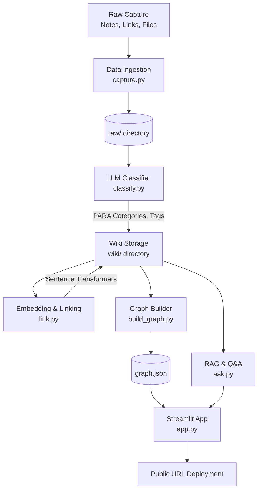

# SecondSelf Architecture

Based on the problem statement, SecondSelf is an end-to-end knowledge capture, organization, and retrieval system. The architecture is broken down into four distinct subsystems that act as a pipeline.

## 1. System Overview

## 2. Component Architecture

### Phase 1: Data Ingestion (The Archivist)
- **Role:** Centralized intake for unstructured data.
- **Component:** `capture.py` CLI script.
- **Storage:** Writes unorganized, timestamped data to the `raw/` local directory. Every item is assigned a UUID.
- **Data format:** Plain text, URLs, or binary files.

### Phase 2: Processing & Organization (The Librarian)
This phase acts as the brain's "background processing," shifting raw data into structured knowledge.
- **Classification Engine (`classify.py`):**
  - **Function:** Reads from `raw/`.
  - **AI Model:** Fast LLM (e.g., Groq / Llama 3) via API.
  - **Output:** Categorizes items using the PARA method (Projects, Areas, Resources, Archives), generates a summary, and assigns tags.
- **Embedding & Linking Engine (`link.py`):**
  - **Function:** Identifies latent relationships between notes without manual tagging.
  - **AI Model:** Local `sentence-transformers` (e.g., all-MiniLM-L6-v2) for generating dense vector embeddings of text.
  - **Mechanism:** Computes cosine similarity across all notes in the `wiki/` directory. When similarity exceeds a defined threshold, an automated link/reference is injected into the notes.
- **Storage:** The processed, linked, and tagged Markdown notes reside in the `wiki/` directory.

### Phase 3: Knowledge Representation (The Cartographer)
- **Role:** Prepares the structured knowledge base for visual consumption.
- **Component:** `build_graph.py` script.
- **Mechanism:** Scans the `wiki/` directory for links, generating a nodes-and-edges data model.
- **Storage:** Exports the relationships to `graph.json` for fast front-end rendering.

### Phase 4: User Interface & Retrieval (The Oracle)
This is the user-facing web application that brings the backend pipeline to life.
- **RAG Engine (`ask.py`):** 
  - Uses the computed vector embeddings to retrieve relevant context from `wiki/` based on a user query.
  - Uses an LLM to synthesize the retrieved context into a natural language answer.
- **Web Application (`app.py`):**
  - **Framework:** Streamlit
  - **Visualizer:** Cytoscape.js or `vis-network` (via a Streamlit component like `streamlit-agraph`) to render a force-directed graph.
  - **Features:** 
    1. A living visual graph representing the user's knowledge, where nodes can be hovered to reveal content.
    2. A search bar for natural language Q&A against the database.
- **Deployment:** Streamlit Community Cloud or Hugging Face Spaces for public access.

## 3. Technology Stack Summary

| Layer | Technology |
| :--- | :--- |
| **Language** | Python 3.10+ |
| **UI Framework** | Streamlit |
| **Graph Visualization** | `streamlit-agraph` (vis.js) or Cytoscape |
| **LLM Provider** | Groq API (Llama 3) for speed and low cost |
| **Embeddings** | `sentence-transformers` (local execution) |
| **Storage** | Local Filesystem (`raw/`, `wiki/`, `graph.json`) |

